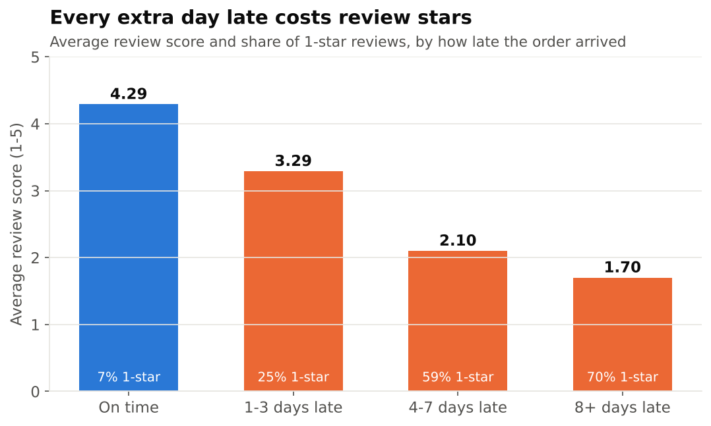
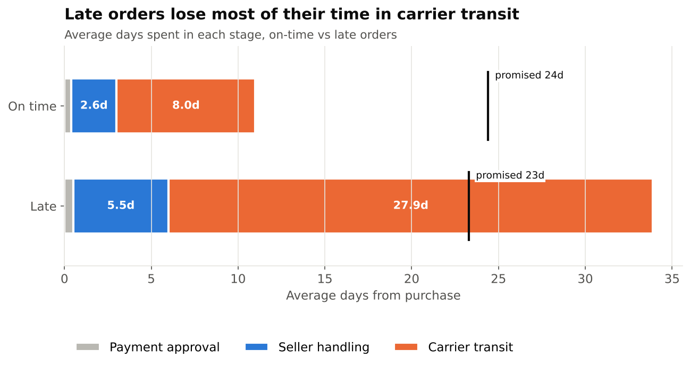
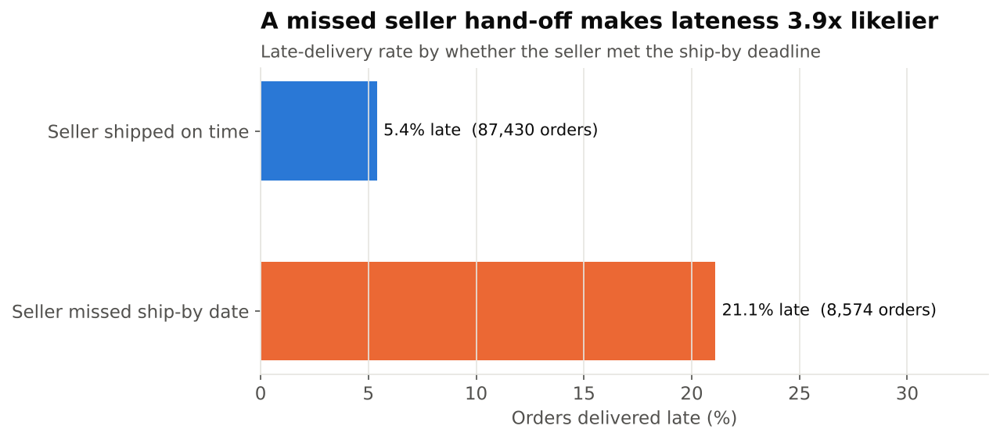
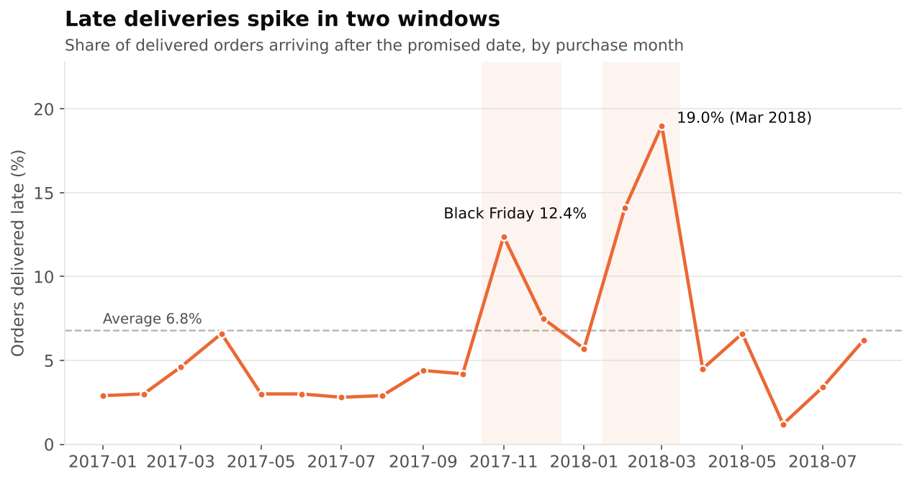
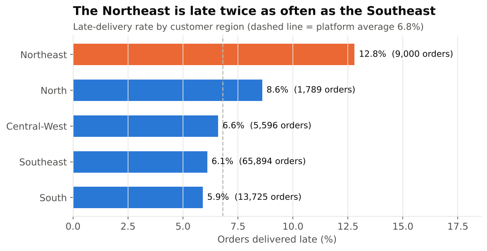
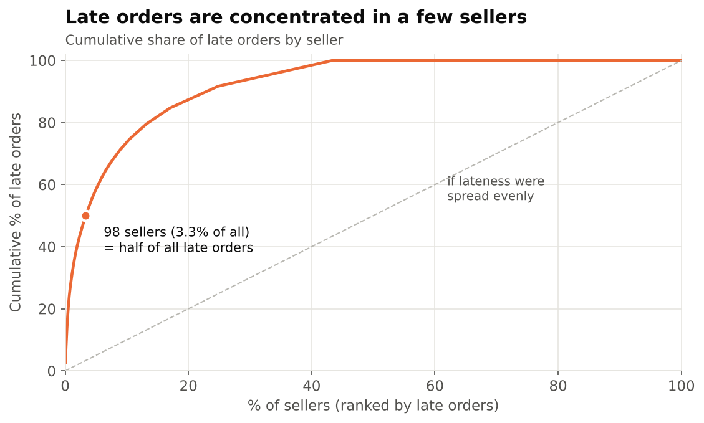

# E-commerce Delivery Performance: from analysis to solution

**One business problem, worked end to end the way a Business Analyst would:**
find out what's going wrong, size it, recommend what to do, then specify the fix.

Built on the [Olist Brazilian E-Commerce dataset](https://www.kaggle.com/datasets/olistbr/brazilian-ecommerce):
real, anonymised marketplace data with ~100k orders (2016–2018) across 9 linked tables.

| Part | Question | Skills shown | Status |
|---|---|---|---|
| **1. Delivery performance analysis** | Why are deliveries late, and what does it cost us? | SQL (CTEs, window functions), star-schema modelling, data quality, Python, Power BI, recommendation writing | ✅ Complete |
| **2. BA case study: late-delivery early warning** | What process and system change fixes it? | Stakeholder analysis, process mapping, BRD, user stories, acceptance criteria, UAT | 🔜 In progress |
| **3. AI reporting assistant** | Can the weekly ops report write itself? | Python, LLM API, text-to-SQL | 🔜 Planned |

---

## Part 1: Delivery performance analysis

### The business problem
Olist is a marketplace: independent sellers pack the order, then a carrier delivers it.
At checkout the customer is shown a promised delivery date. Leadership wants to know
**how often we break that promise, why, and what it's costing us**, and where to act first.

### Headline numbers
*96,004 delivered orders, Jan 2017 – Aug 2018, R$15.3M GMV*

| Metric | Value |
|---|---|
| Orders delivered late | **6.8%** (6,528 orders) |
| Share of all 1-star reviews that come from late orders | **36.9%** |
| Average review: on time vs 8+ days late | **4.29 vs 1.70** |
| Late rate when seller misses ship-by deadline | **21.1%** vs 5.4% (3.9x) |
| Late orders where the seller shipped on time | **72%** (the carrier leg is the main problem) |
| Sellers responsible for half of all late orders | **98 of 2,931** (3.3%) |

### Key findings

**1. Lateness is a customer-satisfaction problem, not just an ops metric.**
Only 6.8% of orders arrive late, but they generate 36.9% of all 1-star reviews.
Even 1–3 days late drops the average review by a full star.



**2. The carrier leg is where late orders lose their time.**
Late orders spend 27.9 days in carrier transit vs 8.0 days for on-time orders.
Seller handling also doubles (5.5 vs 2.6 days) but is the smaller gap.
72% of late orders had a seller who handed over on time.



**3. Sellers still matter: a missed hand-off makes lateness 3.9x likelier.**
8.9% of orders miss the seller's ship-by deadline, and 21.1% of those arrive late.



**4. Two regions and two time windows drive the problem.**
- The Northeast runs at 12.8% late, twice the Southeast. **Rio de Janeiro** alone
  (12.2% late on 12,289 orders) accounts for **24% of all late orders**, the second-largest
  share after São Paulo despite being a third of its size.
- Interstate shipments run late 8.1% of the time vs 4.5% within the same state.
- Late rates jumped to 10.3% in Nov–Dec 2017 (Black Friday) and 16.6% in Feb–Mar 2018,
  vs 4.2% in other months. In both windows monthly volume was ~50% above normal,
  but **promised delivery times didn't adjust** (≈24 days throughout).




**5. Late orders are concentrated, so they're actionable.**
3.3% of sellers account for half of late orders. A watchlist of 44 high-volume sellers
with a late rate ≥12% is in [`outputs/q12_seller_watchlist.csv`](outputs/q12_seller_watchlist.csv),
each tagged as *seller-driven* (misses ship-by dates) or *route-driven* (ships on time, still late).



### Recommendations
Full reasoning in the [recommendation memo](docs/recommendation_memo.md).

1. **Carrier lane review for Rio de Janeiro and the Northeast.** These are the biggest pools of
   carrier-driven lateness. Set lane-level transit SLAs and re-tender the worst lanes.
2. **Seller ship-by SLA programme** starting with the 44-seller watchlist: coach the
   seller-driven group on handling time; move the route-driven group to better lanes.
3. **Peak-season promise dates.** Lengthen the promised date automatically when volume
   is running well above normal, so the promise stays honest when capacity is stretched.
4. **Late-delivery early warning.** Flag at-risk orders (missed hand-off, long lane, peak period)
   and contact the customer *before* the promise is broken. **→ This is specified in Part 2.**

**Sizing:** halving lateness would remove ~1,500 one-star reviews (16% of all) and lift the
average review from 4.16 to 4.22. Customers whose first order was late also came back less
often (2.72% vs 3.51% repeat rate). Repeat buying is low on this platform overall,
so treat that as directional.

### How it's built

```
raw CSVs ─► 01_staging.sql ─► 02_star_schema.sql ─► 03_data_quality.sql ─► 04_analysis.sql ─► outputs/ + charts/
                (clean)          (fact + dims)          (11 checks)            (14 questions)          │
                                       └──────────────► data/processed/*.csv ─► Power BI dashboard ◄──┘
```

- **Data model:** `fact_orders` (order grain, with each delivery stage pre-calculated),
  `fact_order_items`, and `dim_customer`, `dim_seller`, `dim_product`, `dim_date`.
  See the [data dictionary](docs/data_dictionary.md).
- **Data quality:** 11 documented rules (impossible timestamps, duplicate reviews, missing
  categories, multi-seller orders, …). See the [data quality log](docs/data_quality_log.md).
- **Analysis:** 14 business questions in [`sql/04_analysis.sql`](sql/04_analysis.sql), each saved
  to `outputs/` and to one workbook, [`outputs/analysis_results.xlsx`](outputs/analysis_results.xlsx).
- **Dashboard:** Power BI, built on the same star schema. See [`powerbi/`](powerbi/).

### Run it yourself

```bash
pip install -r requirements.txt
# download the dataset into data/raw/ (see data/README.md)
python scripts/run_pipeline.py
```
Runs in under a minute on a laptop. SQL runs on [DuckDB](https://duckdb.org) (no database
server needed), and the syntax ports easily to Snowflake or Postgres.

### Repository layout
```
├── sql/                 01 staging → 02 star schema → 03 data quality → 04 analysis
├── scripts/             run_pipeline.py (one command), make_charts.py
├── outputs/             one CSV per business question + analysis_results.xlsx
├── charts/              figures used in this README
├── powerbi/             dashboard build guide, DAX measures, screenshots
├── docs/                recommendation memo, data dictionary, data quality log
└── data/                raw/ (download) and processed/ (generated), not committed
```
