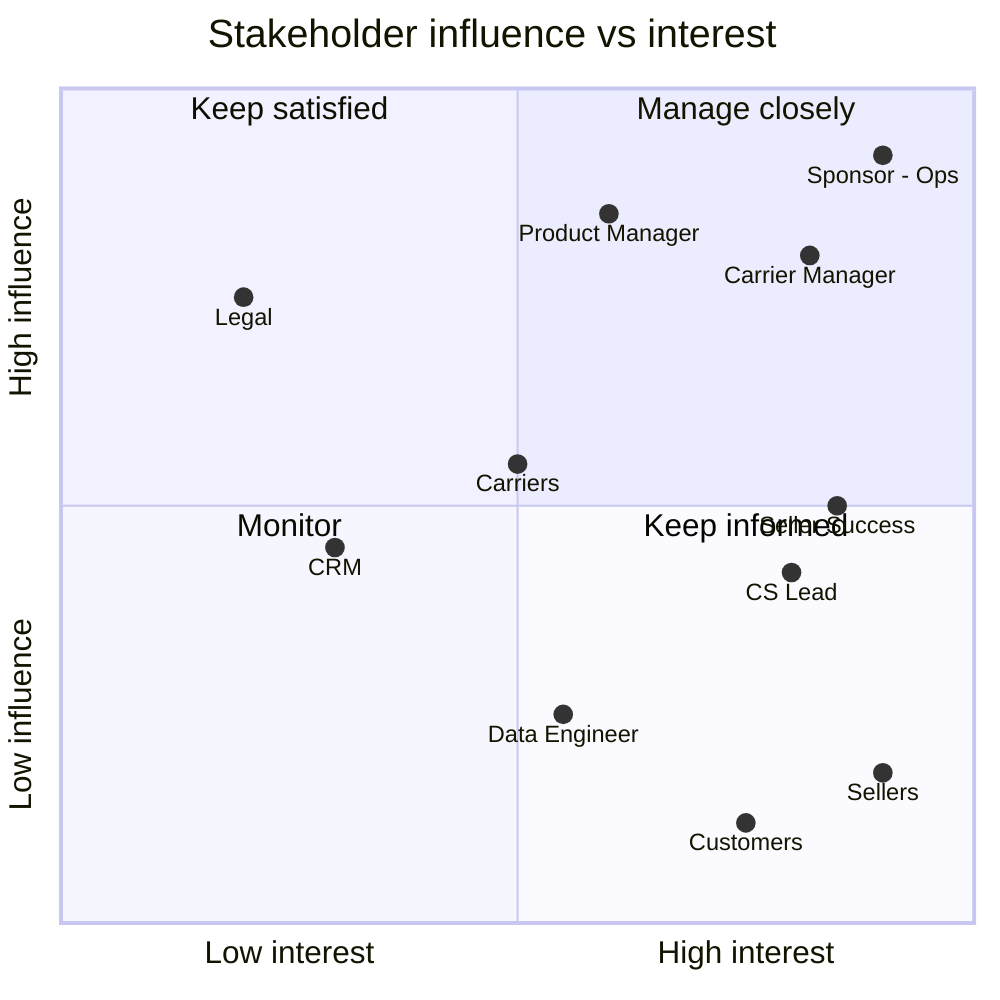

# 2. Stakeholder analysis

> Roles are illustrative for the portfolio scenario. Each one's concerns are grounded in the Part 1 findings.

## Stakeholder register
| # | Stakeholder | Role in this initiative | What they care about | Influence | Interest |
|---|---|---|---|---|---|
| S1 | Head of Marketplace Ops | **Sponsor**, approves scope and budget | Review score, late rate, cost | High | High |
| S2 | Logistics & Carrier Manager | Owns carrier contracts and lane SLAs | Evidence to push carriers; not being blamed for seller delays | High | High |
| S3 | Seller Success Lead | Owns account managers and seller relationships | Seller churn, fairness of flags | Medium | High |
| S4 | Customer Service Lead | Owns CS agents and contact volumes | Fewer WISMO contacts, clear scripts | Medium | High |
| S5 | Product Manager, Order Platform | Owns the backlog and delivery | Effort, dependencies, clean requirements | High | Medium |
| S6 | Data Engineer | Builds the scoring job and data feeds | Data availability, job reliability | Low | Medium |
| S7 | CRM / Marketing | Owns customer message templates and sending | Brand tone, unsubscribe rates | Medium | Low |
| S8 | Legal / Data Protection | Confirms LGPD compliance of messages | Consent, data minimisation | High | Low |
| S9 | Sellers (external) | Receive reminders and flags | Not being penalised unfairly | Low | High |
| S10 | Customers (external) | Receive delay notices | Knowing what's happening | Low | High |
| S11 | Carriers (external) | Receive lane escalations | Volume, contract terms | Medium | Medium |

## Power / interest grid

| Quadrant | Who | Engagement |
|---|---|---|
| **Manage closely** | Sponsor, Carrier Manager, Product Manager | Weekly check-in, sign-off on BRD and rule thresholds |
| **Keep satisfied** | Legal | Review at BRD draft and before launch |
| **Keep informed** | Seller Success, CS Lead, sellers, customers | Requirements workshops; demo at end of each sprint |
| **Monitor** | CRM, Data Engineer, carriers | Involved in their specific tasks |

## RACI
R = Responsible (does it) · A = Accountable (signs off) · C = Consulted · I = Informed

| Activity | Ops Head | Carrier Mgr | Seller Success | CS Lead | Product Mgr | Data Eng | CRM | Legal | BA |
|---|---|---|---|---|---|---|---|---|---|
| Approve business case | **A** | C | C | C | C | I | I | I | R |
| Define risk rule and thresholds | **A** | C | C | I | C | C | I | I | R |
| Approve BRD | **A** | C | C | C | R | C | C | C | R |
| Build scoring job | I | I | I | I | **A** | R | I | I | C |
| Customer message templates | I | I | I | C | C | I | **A/R** | C | C |
| LGPD review | I | I | I | I | C | I | C | **A/R** | C |
| Carrier escalation process | C | **A/R** | I | I | C | I | I | I | C |
| Seller reminder content and policy | C | I | **A/R** | I | C | I | C | I | C |
| UAT | I | C | C | C | **A** | C | C | I | R |
| Go / no-go after pilot | **A** | C | C | C | R | I | I | I | R |

## Elicitation plan
| Technique | With | Goal | Example questions |
|---|---|---|---|
| Data analysis | n/a | Size the problem, find drivers | Done in Part 1 |
| 1:1 interviews | Ops Head, Carrier Mgr | Objectives, constraints, appetite for false alarms | "If we flag 35 orders a day and 1 in 5 is really late, is that acceptable?" |
| Workshop | Seller Success, CS Lead, Product Mgr | Map current process, agree future process | "Walk me through what happens when a customer asks where their order is." |
| Document review | Carrier contracts | Existing SLA terms | "Do contracts define lane-level transit times?" |
| Prototype review | CS Lead, CRM | Message wording, dashboard layout | "Would an agent know what to do from this screen?" |

## Key stakeholder concerns and how the design answers them
| Concern | From | Design response |
|---|---|---|
| "Don't blame carriers for seller delays" | Carrier Mgr | Seller-side and carrier-side signals are tracked separately; the escalation only uses orders handed over on time (FR-11) |
| "Flags must be fair to sellers" | Seller Success | Sellers get a reminder before any flag (FR-01); flags use their own ship-by deadline, not delivery outcome |
| "Agents need a script, not a number" | CS Lead | Alert shows plain-English reason and revised date range (FR-09) |
| "Don't spam customers" | CRM | Maximum one proactive message per order (BRL-09); opt-out respected (FR-08) |
