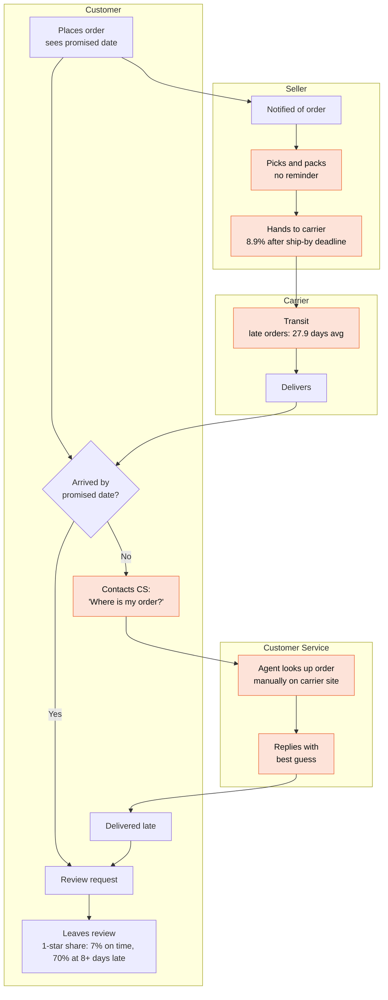
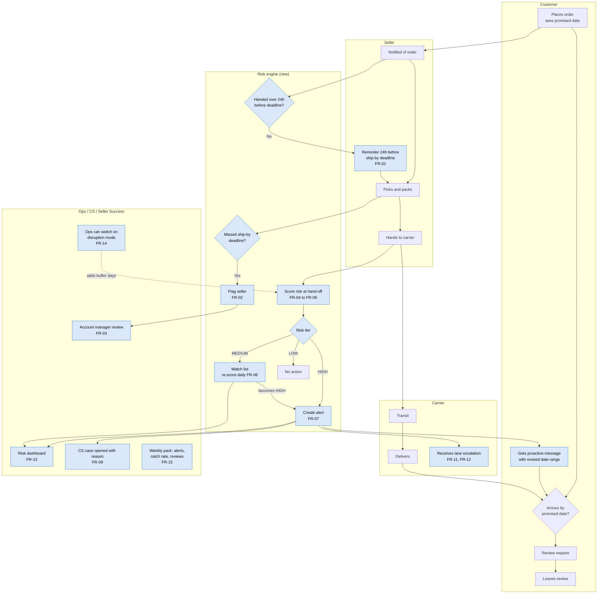
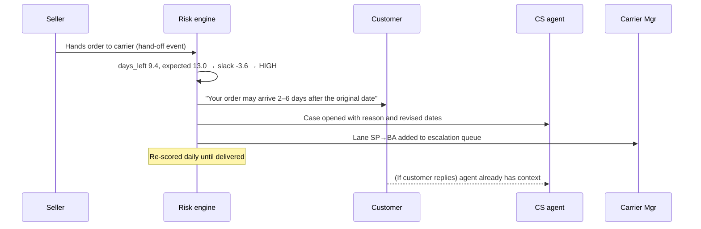

# 3. Process maps

## 3.1 Current state (as-is)
Nothing in today's process looks at an order between the seller notification and the customer complaint.

*Orange = pain point.*

### Pain points
| # | Pain point | Evidence (Part 1) | Who feels it |
|---|---|---|---|
| P1 | Sellers get no reminder before the ship-by deadline | 8.9% of orders handed over late | Sellers, customers |
| P2 | A missed hand-off isn't flagged to anyone | Missed hand-off → 21.1% late vs 5.4% | Seller Success |
| P3 | No one watches orders in transit | Late orders spend 27.9 days with the carrier | Ops, carriers |
| P4 | The customer finds out the order is late before we do | 36.9% of 1-star reviews come from late orders | Customers, CS |
| P5 | CS investigates each case manually | Agent checks the carrier site order by order | CS |
| P6 | Carrier problems are anecdotal, not lane-level | RJ = 24% of late orders, Northeast 12.8% late, no lane report | Carrier Mgr |

## 3.2 Future state (to-be)
New steps are in **blue**. Numbers refer to the functional requirements in the [BRD](04_brd.md).

### What a HIGH alert looks like end to end

## 3.3 Gap analysis
| Area | Current | Future | Gap to close | Requirement |
|---|---|---|---|---|
| Seller deadline | No reminder | Reminder 24h before; flag if missed | Reminder logic, seller notification channel | FR-01, FR-02, FR-03 |
| Risk visibility | None until complaint | Every order scored at hand-off and daily | Lane benchmarks, live signal, scoring job | FR-04 – FR-06 |
| Customer comms | Reactive (customer asks) | Proactive for HIGH risk | Message templates, consent check, A/B split | FR-07, FR-08, FR-10 |
| CS handling | Manual carrier look-up | Case pre-filled with reason and dates | CS case integration | FR-09 |
| Carrier management | Anecdotal | Lane-level escalation with evidence | Escalation queue and report | FR-11, FR-12 |
| Disruptions | No mechanism | Ops can add buffer days by region | Config screen | FR-14 |
| Measurement | Late % only | Catch rate, alert volume, review uplift | Weekly pack, A/B tracking | FR-15, FR-16 |
