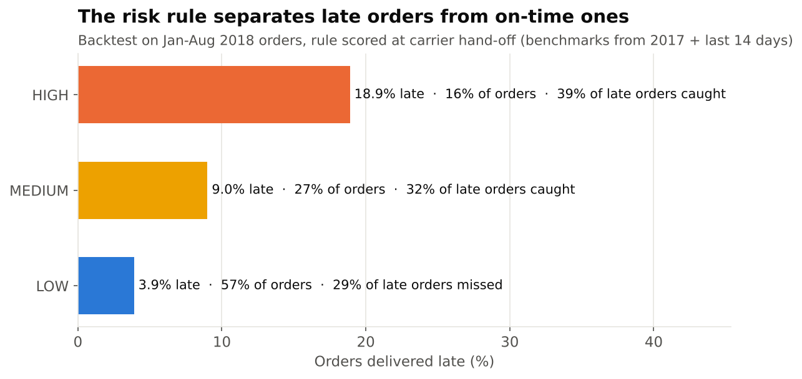

# 8. Rule backtest: does the early warning actually work?

Before writing requirements around a risk rule, I tested it on real orders.
Code: [`sql/05_early_warning_backtest.sql`](../sql/05_early_warning_backtest.sql). Results:
[`outputs/bt01`–`bt04`](../outputs/), regenerated by `python scripts/run_pipeline.py`.

## Method
- **Score each order at the moment the seller hands it to the carrier**, the earliest point where the carrier leg can be judged.
- **No hindsight.** Route benchmarks come from **2017 orders only**. The live signal uses only deliveries **completed before** the hand-off.
- **Test on 52,612 orders from Jan–Aug 2018**, of which 7.8% arrived late.
- The rule (BRL-01 to BRL-06): compare the days left before the promise with the time the route is expected to take (75th percentile). Use the larger of the 2017 lane history and the last 14 days' deliveries to the same state.

## Result: the recommended rule (option B)

| Tier | Share of orders | Late rate | Share of all late orders | Avg review |
|---|---|---|---|---|
| HIGH | 16.1% | **18.9%** | **39.4%** | 3.94 |
| MEDIUM | 27.3% | 9.0% | 31.8% | 4.10 |
| LOW | 56.6% | **3.9%** | 28.8% | 4.22 |

- HIGH orders are **2.4x** as likely to be late as the average order (18.9% vs 7.8%), and **4.8x** as likely as LOW orders.
- HIGH and MEDIUM together catch **71%** of late orders.
- **Warning time:** for late orders flagged HIGH, the median warning is **11.8 days** before the promised date. 74% get at least 3 days' warning, which is enough time for a proactive message to matter.

## The trade-off the business has to choose
More sensitive rules catch more late orders but flag more on-time ones.

| Option | Rule | HIGH share of orders | HIGH precision | Late orders caught by HIGH | HIGH alerts / day |
|---|---|---|---|---|---|
| A | History only | 7.5% | 23.5% | 22.7% | 16 |
| **B** | **History + live (recommended)** | **16.1%** | **18.9%** | **39.4%** | **35** |
| C | History + live, HIGH if slack < 2 | 25.6% | 15.5% | 51.0% | 56 |
| D | History + live, HIGH if slack < 3 | 30.4% | 14.5% | 56.7% | 67 |

**Why B:**
- Adding the live signal (A → B) catches **74% more late orders** (39.4% vs 22.7%) for a modest drop in precision.
- Going further (C, D) adds alerts faster than it adds catches.
- 35 alerts a day is within what CS can absorb with pre-filled cases. This is open question Q1 in the BRD.

## Where the rule struggles, and what the BRD does about it
| Month | Late rate | HIGH catches | Note |
|---|---|---|---|
| Jan 2018 | 5.7% | 35.0% | |
| **Feb 2018** | **14.1%** | **21.1%** | Sudden network-wide slowdown; the live signal lags behind it |
| Mar 2018 | 19.0% | 32.7% | Live signal catching up |
| Apr 2018 | 4.5% | 64.1% | |
| Aug 2018 | 6.2% | 90.3% | Promised dates were shortened to ~16 days, so more orders score HIGH (76/day) |

- **The first weeks of a disruption are the weak spot.** The live signal needs deliveries to complete before it can see the slowdown. → **FR-14 Disruption mode** lets Ops add buffer days immediately.
- **Alert volume follows the promise length.** When promised dates were cut in August 2018, HIGH alerts more than doubled. → **NFR-02** sizes capacity for that, and the weekly pack tracks alerts per day.
- **81% of HIGH orders still arrive on time.** → Messages say "may arrive", and the pilot measures the effect on on-time HIGH orders (BRD §11).

## Limitations
- The backtest scores at hand-off only. The daily re-score (FR-06) should catch more, but needs in-transit scan data that the public dataset doesn't have.
- Seller state is used as the lane origin; real lanes would use carrier and depot.
- It shows the rule *identifies* risk. Whether *messaging* improves reviews can only be proven by the pilot's A/B test.
