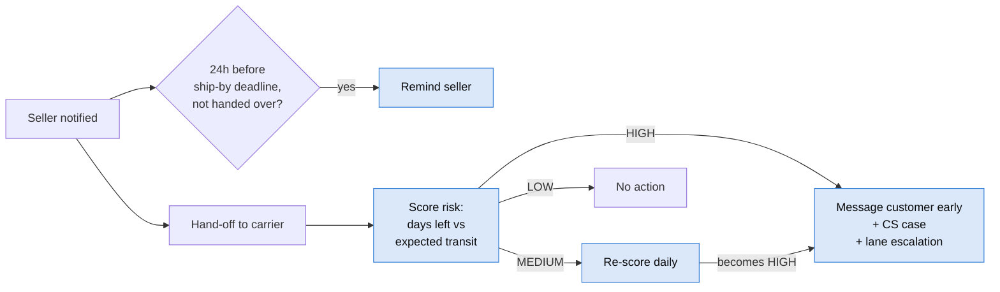

# Part 2: BA case study, Delivery Risk Alerts

**Part 1 found the problem. Part 2 designs the fix.** This is the full set of business analysis
artefacts for a late-delivery early-warning capability. Every requirement traces back to a Part 1
finding, and the core business rule was **backtested on real orders** before being written into the BRD.

> Portfolio scenario: all data and numbers are real (Olist public dataset). The organisation,
> stakeholder roles and sign-offs are a realistic scenario built around that data.

## The solution in one picture


## Headline evidence
| | |
|---|---|
| Problem | 6.8% of orders late → 36.9% of all 1-star reviews |
| Rule precision | HIGH-risk orders late **18.9%** of the time vs **3.9%** for LOW |
| Rule coverage | HIGH catches **39%** of late orders; HIGH + MEDIUM catch **71%** |
| Warning time | Median **11.8 days** before the promised date |
| Alert load | ~**35 HIGH alerts a day** |
| Tests | **24 / 24** automated rule tests pass |

## Artefacts
| # | Document | What it shows |
|---|---|---|
| 1 | [Business case](01_business_case.md) | Problem, SMART objectives, scope, benefits, risks, recommendation |
| 2 | [Stakeholder analysis](02_stakeholders.md) | Register, power/interest grid, RACI, elicitation plan |
| 3 | [Process maps](03_process_maps.md) | Current and future state (swimlanes), sequence diagram, pain points, gap analysis |
| 4 | [BRD](04_brd.md) | 6 business reqs, 16 functional reqs, 16 business rules with a worked example, data and non-functional reqs, pilot design |
| 5 | [User stories](05_user_stories.md) | 5 epics, 13 stories, Given/When/Then acceptance criteria, sprint plan |
| 6 | [UAT plan](06_uat_plan.md) | Automated rule tests + manual workflow scripts, entry/exit criteria, defect severity |
| 7 | [Traceability matrix](07_traceability_matrix.md) | Evidence → BR → FR → rules → stories → tests, with a coverage check |
| 8 | [Rule backtest](08_rule_backtest.md) | Does the rule work? Precision, coverage, threshold trade-off, weak spots |

## Run the tests
```bash
python part2_ba_case_study/uat/run_uat.py          # 24 rule tests → uat/uat_results.md
python scripts/run_pipeline.py                     # re-runs the backtest (sql/05) with Part 1
```

## Skills demonstrated
Requirements elicitation planning · stakeholder management · process modelling (BPMN-style swimlanes in Mermaid) ·
BRD writing · business rules · user stories and acceptance criteria (Gherkin) · MoSCoW prioritisation ·
UAT design · requirements traceability · A/B pilot design · evidence-based decision making (backtest in SQL)
